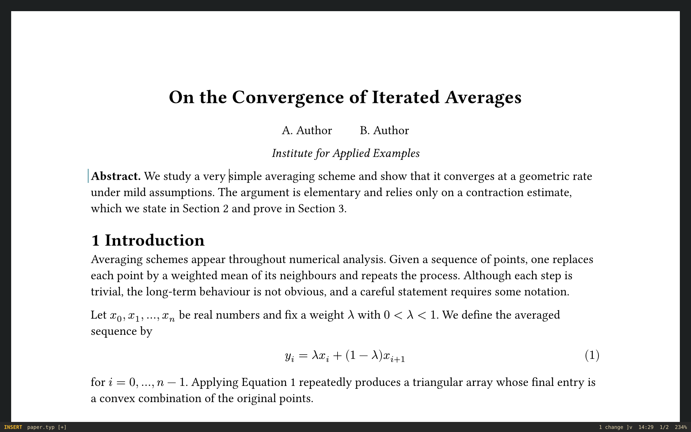
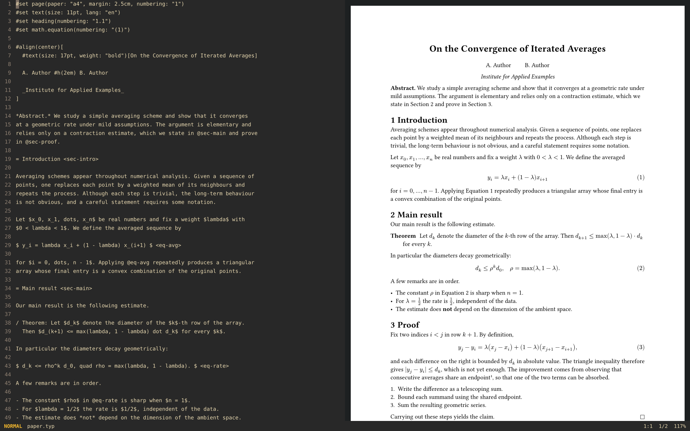
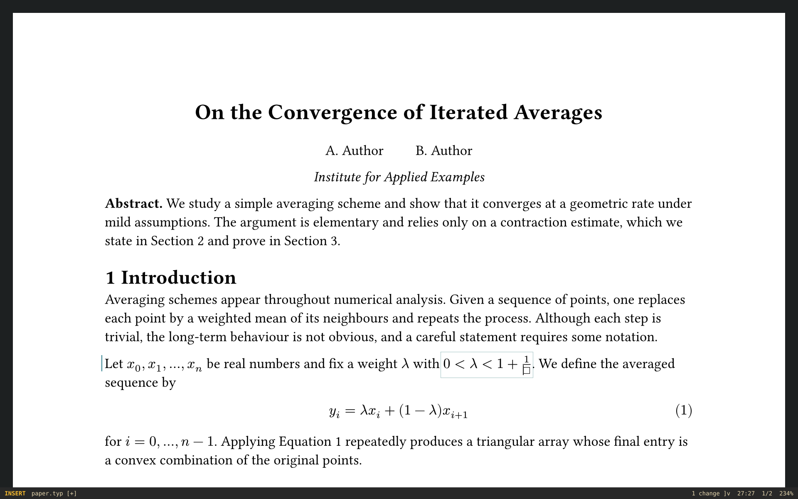
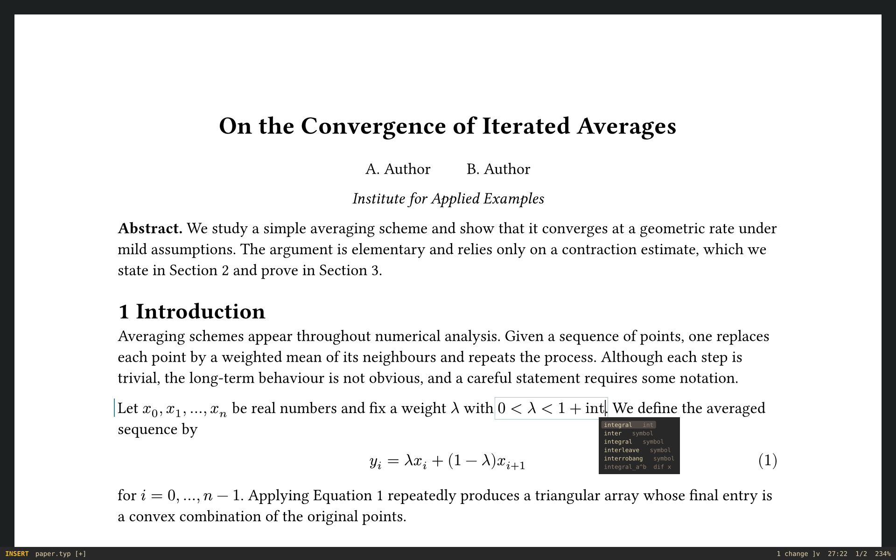
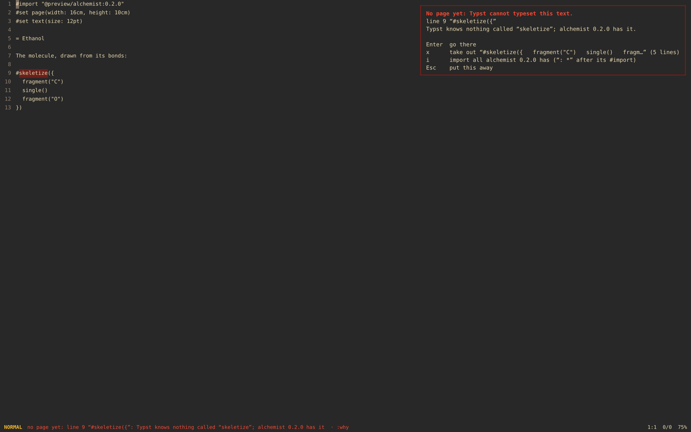
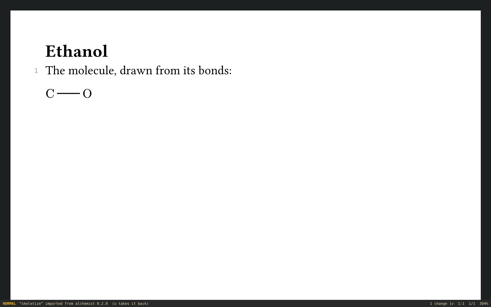
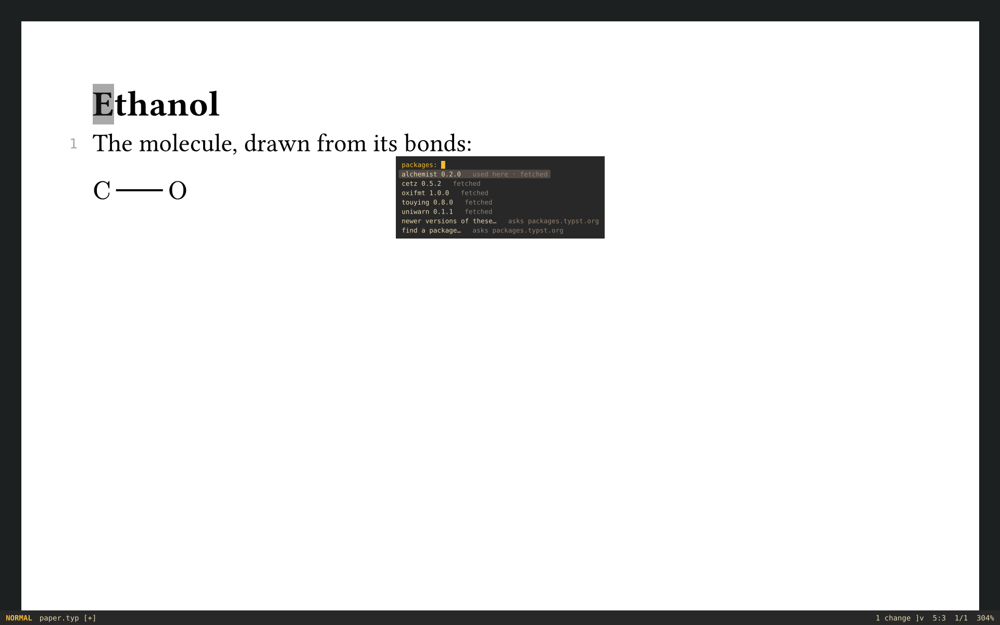
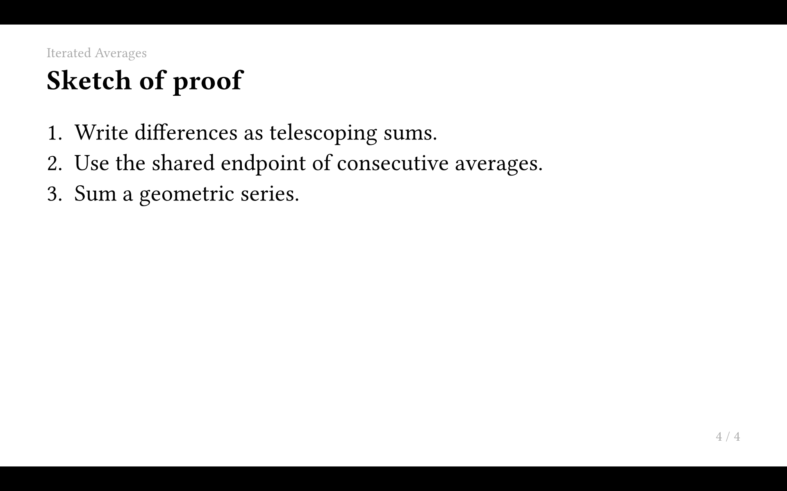
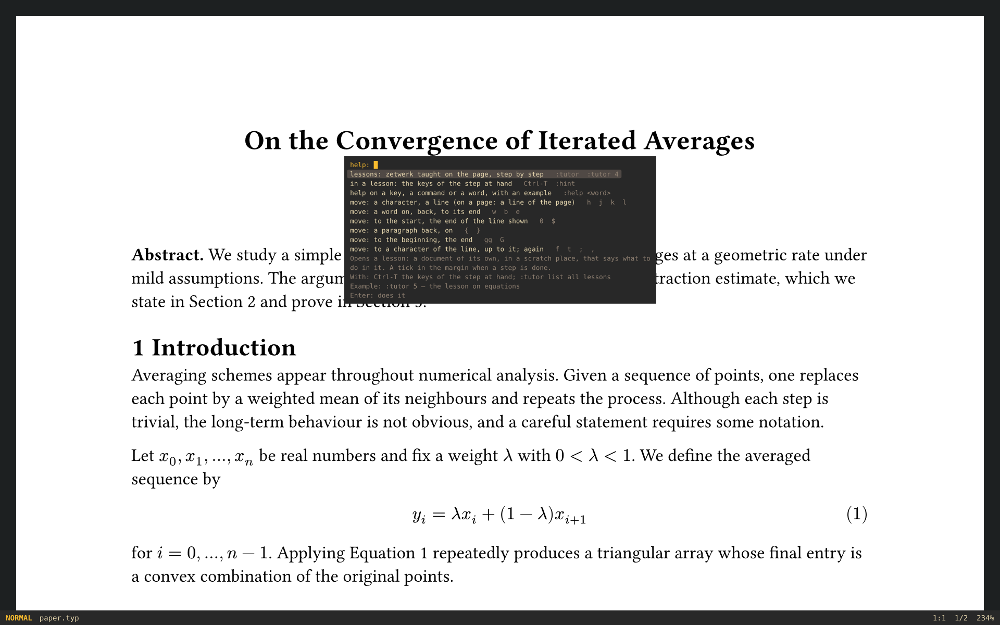

# zetwerk

**A keyboard-driven editor where the typeset Typst page *is* the editor.**

You type on the page, with Vim's keys, and see the document as it will
print while you write it. The `.typ` file stays plain Typst: it works with
the `typst` command line and with git, and there is nothing else to keep
in sync.



## At a glance

- **Write on the page.** The cursor is on the typeset page. Words go in
  where you type them, and the source is one key away (`gs`) when you want it.
- **Fast on a laptop.** A key never waits for the whole document to be
  typeset. Typed words are worked into the page directly, other changes are
  typeset on their own in a few milliseconds, and the whole document follows
  when you pause. Nothing runs while you're idle.
- **Vim, properly.** Modes, operators and motions, counts, text objects,
  registers, dot-repeat, macros and `:` commands, plus text objects that
  know about Typst.
- **Equations as you type them.** Unfinished equations stay equations,
  with empty boxes for what's still missing. Brackets close themselves,
  symbol names complete, and pasted or typed LaTeX becomes Typst.
- **Errors in plain words.** When Typst refuses the text, `:why` says
  what's wrong and offers to fix it: correct a misspelt name, take out what
  doesn't work, import the package that has the name, or go back to the
  last text that typeset.
- **Papers, theses and talks.** References, citations and bibliographies,
  figures, tables, footnotes, multi-file projects, packages and templates,
  slides (touying), presenting and handouts.
- **AI agents welcome.** `zetwerk mcp` is an MCP server, so an agent such as
  Claude Code can work on the open document. Its changes can go in live, or
  wait as proposals for you to accept.
- **Safe.** You save with `:w`, and every edit is journaled on disk first.
  A crash loses nothing.

## Install

zetwerk is written in Rust (1.92 or newer) on top of Typst 0.15. It's
developed on Linux (Wayland and X11).

```sh
git clone https://github.com/jakobjava/zetwerk
cd zetwerk
./scripts/install.sh          # builds a release and puts it in ~/.local/bin
```

`./scripts/install.sh remove` takes it all away again. On Arch,
`packaging/arch/PKGBUILD` builds a package (`makepkg -si` in that
directory).

Optional extras: `wl-clipboard` or `xclip` for the system clipboard, and
Hunspell dictionaries (`hunspell-en_gb`, `hunspell-de`, …) for spelling.

## First steps

```sh
zetwerk thesis.typ            # open a document (or a directory)
```

| Keys | What they do |
| --- | --- |
| `i` … `Esc` | type on the page, then back to normal mode |
| `gs` | page → page beside its source → source alone → page |
| `:w` | save |
| `g?` | everything there is to do, searchable, with help on each |
| `:tutor` | lessons, taught on the page, in about twenty minutes |
| `:why` | why Typst refuses the text, and the ways out |
| `Ctrl-G` | write a report of what just happened, to replay it |

---

## The showcase

### The page is the editor

The cursor sits in the typeset text. Moving, deleting, changing words and
sentences, `ciw`, `dap`, `.`: all of it works on what you see. A word typed
into a paragraph is fitted into its line right away, without asking Typst.
Anything bigger is typeset on its own and put into the page, so one key costs
the same in a 300-page thesis as in a letter. The whole document is typeset
again when you pause, and then it settles what a part can't know, such as
numbers and page breaks.

The screenshot at the top is the page view in the middle of typing ("a very
simple averaging scheme"). The status line shows the mode, the file, the
changes since saving, the cursor's line and column, the page and the zoom.

### The source, one key away



`gs` puts the source beside the page, then the source alone, then just the
page again. Both views share one cursor. In the source view, `/` searches
what's written; on the page, it searches what you read.

### Equations that stay equations while you type them



Half an equation is usually no equation: `frac(1,` lacks its denominator, and
Typst refuses it. zetwerk shows what's still to come as an empty box `□`,
leaves nothing of it in the file, and keeps the equation typeset while you
type. `(` and `[` close themselves (typing the closing one steps over it).
After a blank (out of an exponent, say), the cursor stands where the next
symbol will go, as large as it will be. Typing at the end of a display
equation keeps it a display equation.



Names complete as you type: symbols, functions and templates such as
`integral_a^b dif x`. A word that isn't a name yet is shown as you typed it
until it is one. LaTeX typed or pasted into an equation (`\alpha`,
`\frac{a}{b}`) becomes Typst. Labels, references and numbering work as in
any Typst document.

### When Typst says no



If the text can't be typeset, the status line says where and why, in plain
words. `:why` opens a panel with the ways out. `Enter` goes there, `x` takes
out what Typst refuses, `c` corrects a misspelt name (`pagsgse` → `page`),
`u` undoes back to the text the page shows, and `e` reloads the saved file.

Here a snippet from alchemist's manual was pasted into a document that
imports alchemist without its names. alchemist is on the machine, so the
panel offers `i`, which imports what it has, as one undo step:



### Packages without a terminal



`:packages` lists what the document imports and what's on the machine.
`:package search` finds packages in Typst's registry, and choosing one
writes its `#import` and fetches it. A document that needs a package the
machine doesn't have says so, and `g` in `:why` fetches it. Nothing is
fetched unless you ask, and nothing of the document is ever sent.
Templates from packages are offered by `:new`.

### Slides and talks



Decks made with touying are edited like any other document. `:present` shows
them full screen, slide by slide, with an optional clock and a duration for
the talk (`:present 30min`), and `:present rehearse` times each slide.
`:pdf` exports the document, and `:pdf handout` puts six slides to a page
(only the last step of an animated slide).

### Help where you are



`g?` lists everything zetwerk can do, narrowed as you type, with what each
entry does on the page, an example, and its keys; `Enter` does it.
`:help dd`, `:help footnote` and `:help :pdf` go straight to an entry. `K` on
any part of the document says what it is and what can be done with it. After
a prefix key (`g`, `z`, `]`, …), a list shows what can follow, and `?` gives
help on those. `:tutor` teaches the editor in short lessons, on the page.

### Writing aids

- **Spelling and grammar** in the document's language, with Hunspell and,
  if you run one, LanguageTool: `]s`, `[s`, `z=`, `zg`, `:spell`.
- **Changes since saving** (or since opening, a step of the history, or a
  git commit), listed and gone through with `]v`, and shown as bars beside
  the lines if you want them (`:changes on`, or `changes.bars` in the
  settings; off by default). `:git log` lists the history.
- **Sources:** `:sources` lists the bibliography (BibTeX or Hayagriva).
  You can cite from it and add to it.
- **Comfort:** night and sepia colours (`zn`), a typewriter mode (`zT`), focus
  on the paragraph or sentence (`zf`), and a zen mode (`ze`).
- **Pasting** puts what was copied in as what it is: an image becomes a
  figure (the file is kept beside the document), and cells from a
  spreadsheet become a table.

### AI agents, through MCP

```sh
claude mcp add zetwerk -- zetwerk mcp
```

`zetwerk mcp` connects an agent to the open window, or works on a file
without one. The agent can read the source, the outline and Typst's
diagnostics, render pages, search, insert and replace text, move sections,
add sources, leave notes and answer them, and export a PDF. Each change is
journaled and undoable like your own. With `[ai] edit_mode = "propose"`,
agents' changes wait as suggestions on the page for you to accept or reject
(`:review`). Who wrote what can be tinted on the page. Agents never fetch
packages and never save, unless you allow it.

**The AI pane** (`gI`, or `:ai`) stands beside the page, and it's where
you work with agents. At the top it shows what each agent is doing:
its state, what it says it's working on, a progress bar and its last steps.
Below are your questions and review requests as threads, each with the
text it's about, the agent's answers and its suggestions. You accept or
reject them with `a` and `r`, and Enter takes you to the text. At the
bottom is a line to ask in: type a question about the paragraph or the
selection, or `/review clarity`, `/cite`, `/explain`, `/draft`,
`/check maths`. `Ctrl-W l` and `Ctrl-W h` move between the page and the
pane. `:agents` lists every agent connected, step by step, and
`:agents pause` stops them all from changing anything until you resume.

**An agent on call.** You don't need to keep an agent running in a
terminal. Name your own agent command in the settings, and zetwerk starts it
when you ask agents something: a question at the cursor (`gq` or
`:ask is this step right?`) or a review of what's selected (`gQ`). The agent
gets the task, works in this window through its tools, and stops when it has
answered. The status line says "agent at work" meanwhile. `:agent stop` ends
it, and `:agent log` says where its output is. zetwerk itself still asks no
model anything.

```toml
[ai]
agent = "claude -p --allowedTools mcp__zetwerk"
edit_mode = "propose"
```

### Fast, light and safe

- **No compile for every key.** Typing is a change to the source
  (microseconds), a patch to the page and a redraw of the line. Typst runs
  when you pause. Only what changed on screen is drawn again, and nothing
  runs while you're idle. `[power] mode = "auto"` uses less of the machine
  on battery.
- **Nothing lost.** Edits are journaled before they're shown, so after a
  crash the document opens as it was. Undo is a tree, kept across sessions.
- **Reports.** `Ctrl-G` writes down the last keys, with their timing and
  what the window did with each. `zetwerk --replay` plays them back exactly,
  which turns "that felt wrong" into a test.

## Settings

Settings live in `~/.config/zetwerk/config.toml`, and every one can also be
changed while the window is open (`:set`). For example:

```toml
[view]
layout = "page"        # or "split", "source"
ui_scale = 1.4
colours = "auto"       # day, night, sepia, or the desktop's choice

[ai]
edit_mode = "propose"  # agents' changes wait for you

[packages]
download = "ask"       # or "always", "never"
```

`zetwerk --help` lists all of them.

## License

zetwerk is licensed under either of

- Apache License, Version 2.0 ([LICENSE-APACHE](LICENSE-APACHE))
- MIT license ([LICENSE-MIT](LICENSE-MIT))

at your option.

Unless you explicitly state otherwise, any contribution intentionally
submitted for inclusion in the work by you, as defined in the Apache-2.0
license, shall be dual licensed as above, without any additional terms or
conditions.
